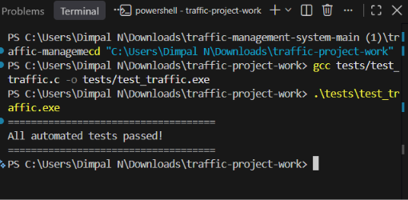

# Unit Test Report

| Item | Details |
|---|---|
| Project | Traffic Management System (Simulation) |
| Team | Team 8 |
| Instructor | Dr. Pradeep Kumar |
| Report date | 11-Nov-2026 |
| Environment | gcc, gcov; automated tests in `tests/test_traffic.c` |

## 1. Summary

| Metric | Value |
|---|---|
| Test functions executed | 14 |
| Passed | 14 |
| Failed | 0 |
| Assertions in suite | 76 |
| Pass rate | 100% |

Build and run:

```
gcc --coverage -O0 -g -o build/run_tests tests/test_traffic.c
./build/run_tests
```

Console output (see `raw/unit_test_output.txt`):

```
====================================
All automated tests passed!
====================================
```

Screenshot of the test run:



## 2. Test Case Results

| # | Test function | Description | Assertions | Related SRS IDs | Result |
|---|---|---|---|---|---|
| 1 | testQueueFIFO | Vehicles leave a lane in the order they arrived; processing an empty lane returns -1 | 5 | TMS-F-001, 002 | Pass |
| 2 | testEmergencyPriority | Emergency vehicle added last is processed first; normal vehicles keep their order | 3 | TMS-F-008 | Pass |
| 3 | testMultipleLanes | Vehicles added to 4 lanes stay in their own lanes and are processed per lane | 8 | TMS-F-004 | Pass |
| 4 | testEmptyQueue | New queue is empty, has size 0, processing it returns -1 | 3 | TMS-F-006 | Pass |
| 5 | testStatistics | Added and processed counters update correctly | 7 | TMS-F-012 | Pass |
| 6 | testQueueLimit | Queue stops at MAX_QUEUE (50); extra vehicle rejected | 2 | TMS-F-006, TMS-SR-002 | Pass |
| 7 | testQueueCompaction | Queue space is reused after vehicles are processed; order preserved | 4 | TMS-NF-002 | Pass |
| 8 | testDensityCounts | Queue sizes at 0, 1, 10 and 11 vehicles are correct | 4 | TMS-F-010, 011 | Pass |
| 9 | testLaneCapacityIndependent | A full lane does not block other lanes | 5 | TMS-F-004, 006 | Pass |
| 10 | testLanesProcessIndependently | Processing one lane does not change another | 6 | TMS-F-004 | Pass |
| 11 | testDensityBoundariesAndDrop | Boundary of 11 vehicles (HIGH) and size drops after processing | 6 | TMS-F-010 | Pass |
| 12 | testInvalidInputs | Invalid lane, vehicle ID and emergency flag are rejected; valid input still works | 16 | TMS-F-005, 014, TMS-SR-001, 003 | Pass |
| 13 | testResetCounters | Reset clears all queues and both counters | 6 | TMS-F-013 | Pass |
| 14 | testStatisticsWaitingAndRejected | Rejected vehicle is not counted; added - processed = waiting | 5 | TMS-F-012 | Pass |

## 3. Defects Found

No failures were found in this run.

## 4. Observation

`tests/test_traffic.c` contains its own copy of the queue functions (`addVehicle`, `processVehicle`, etc.) and tests that copy. It does not include `src/traffic.c`. The unit tests therefore verify the queue logic, but changes made only in `src/traffic.c` are not exercised by these tests. System-level behaviour of the real program is covered in the System Validation Report.

## 5. Conclusion

All 14 unit tests passed (76 of 76 assertions).
